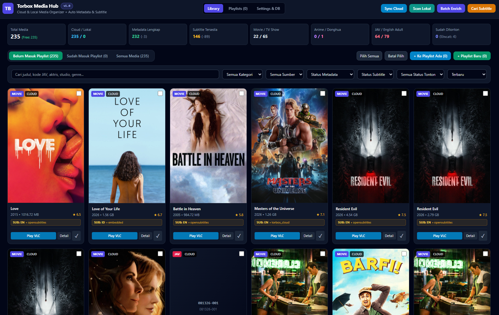

# 🎬 TorBox Media Hub `v1.1`
### Self-Hosted Stremio & Plex Alternative for TorBox — Discover, Check Instant Cache, Auto-Subtitles & Stream Directly to VLC, MPV & Android

[](https://www.python.org/)
[](https://torbox.app/subscription?referral=d8962fcc-d39e-43f6-9a8a-f565bab5f809)
[](https://www.videolan.org/)
[](#installation--platform-guides)
[](https://ko-fi.com/rarafashions)
[](#license)

**TorBox Media Hub** is a fast, lightweight, privacy-first **visual media catalog, multi-indexer cache finder, and direct `.m3u` streaming hub** for **TorBox Cloud** (`Torrents` & `Usenet`) and **local hard drives**—**without downloading a single video file to your device**.

Instead of consuming terabytes of local storage or wrestling with heavy server stacks, TorBox Media Hub lets you browse trending Movies, TV Shows, Anime, Donghua, and specialized catalogs, verify instant TorBox cache availability across 7+ indexers, automatically attach 4-tier subtitles, track missing episodes, and **stream directly from TorBox's high-speed CDN** into **VLC, MPV, IINA, or Android** in one click.

> 🎁 **New to TorBox?** Get **7 bonus days free** when you sign up with our **[Official TorBox Referral Link](https://torbox.app/subscription?referral=d8962fcc-d39e-43f6-9a8a-f565bab5f809)** — works with Essential, Standard, and Pro (Usenet) plans while supporting the continued development of this open-source project!

---

## 🖼️ Preview & Screenshots

| Rich Visual Movie Catalog | Multi-Tier Subtitle Finder | Media Details & Manual Editor |
| :---: | :---: | :---: |
|  |  |  |

---

## ✨ Why TorBox Media Hub?

Managing dozens of cached torrents, Usenet downloads, and local video files from plain text lists is tedious. **TorBox Media Hub** solves the biggest daily pain points for TorBox users without requiring heavy media server stacks like Plex, Jellyfin, Rclone, or FUSE mounts:

* **Zero Local Disk Downloads for Cloud Media:** Your cloud videos stay 100% in the TorBox Cloud while appearing locally as a rich, Netflix-style poster catalog—saving massive amounts of disk space.
* **Instant Buffering-Free Streaming — Never Expires:** Streams videos directly from TorBox's high-speed CDN via on-demand API stream links (`requestdl`) generated right when you click Play or build a playlist—eliminating dead links from expired URLs.
* **4-Category Discovery & Instant Cache Verification:** Browse trending/popular releases or search across **General Movies**, **TV Shows**, **Anime**, and **Donghua**, check TorBox instant-cache availability across 7+ indexers, and queue magnets/NZBs directly to TorBox Cloud. JAV, English Adult, and Indo discovery stay in Roxxy.
* **Automated Download Monitor & Quality Upgrades:** Tracks newly queued TorBox downloads in the background, automatically imports and enriches them upon completion, and supports one-click **Quality Upgrades** (automatically cleaning up the older low-resolution file after the upgrade completes).
* **Series & Episode Completeness Tracking:** Groups TV Shows, Anime, and Donghua by season, compares your library against official episode counts, and flags missing episodes so you can find and add cached replacements immediately.
* **Zero-Hassle Subtitles for Direct Streams:** Automatically inspects embedded tracks (`ffprobe`), extracts sidecar `.srt`/`.ass` files bundled inside your TorBox torrents/Usenet archives, or downloads matching subtitles from OpenSubtitles & SubtitleCat—then injects them directly into your media player.
* **100% Local & Privacy-First:** Runs entirely on your own device using SQLite (`WAL` mode). Only lightweight posters, `.srt` subtitles, and `.m3u` playlist text files are cached locally. Your API keys are write-only masked (`••••••••xxxx`) on the server and never exposed in plain text to the browser.

---

## ⚡ How It Compares to Heavy Media Stacks

| Feature | **TorBox Media Hub** | Plex / Jellyfin + Rclone/Zurg | Standard Stremio Setup |
| :--- | :---: | :---: | :---: |
| **Setup Time** | **2 Minutes** (Pure Python, no FUSE/mounts) | Complex (Docker, WebDAV, Rclone config) | Fast, but relies on external addons |
| **Local Disk Usage** | **Zero** for cloud videos (posters/`.srt` only) | Zero (requires virtual mount stability) | Zero |
| **Built-In Discovery & Cache Check** | **4 Categories** + 7 Torrent/NZB Indexers | Requires Radarr/Sonarr/Prowlarr | Addon-dependent |
| **Isolated Niche Metadata** | **Yes** (TMDb, AniList, JAVDb, TPDB separated) | Often pollutes main movie library | Limited |
| **4-Tier Auto-Subtitle Injection** | **Local + Cloud Archive + `ffprobe` + OpenSubtitles** | Basic / manual plugin setup | External player subtitles often break |
| **Native Android + Desktop Players** | **VLC, MPV, IINA, PotPlayer, Android Intents** | Dedicated client apps required | Built-in player |

---

## 🌐 Multi-Environment & Cross-Platform Capabilities

TorBox Media Hub is built to adapt automatically to the operating system and network environment where it runs:

* **Auto-OS & Player Detection (`/api/players/detect`):** Automatically detects whether it is running on **Windows**, **Linux**, **macOS**, or **Android (Termux)** and scans standard installation paths and system `PATH` for **VLC**, **MPV**, **PotPlayer**, **MPC-HC / MPC-BE**, **IINA**, **Celluloid**, **SMPlayer**, and **Haruna**, plus custom player arguments.
* **Android Intent Integration:** When hosted natively on Android via Termux, TorBox Media Hub launches streams directly into **VLC for Android** (`org.videolan.vlc`), **mpv-android** (`is.xyz.mpv`), or the **Android System Chooser** using native `am start` video intents with subtitle extras (`subtitles_location`).
* **LAN & Headless Server Streaming:** Bind the server to `0.0.0.0` (`TBH_HOST=0.0.0.0`) on a home PC, Linux server, NAS, or Docker container to browse your catalog from any phone, tablet, or TV on your local network. Remote clients can stream local videos via HTTP Range endpoints (`/api/media/<id>/stream`) or download LAN-ready `.m3u` playlists (`/api/playlists/<id>/download`).
* **Hybrid File & Folder Browsing:** Uses native OS file/folder dialogs (`tkinter`) when a desktop GUI is available, and seamlessly falls back to a built-in server-side filesystem browser (`/api/system/list-fs`) in headless Linux, SSH, Docker, or Android Termux environments.
* **Configurable Data Directory (`TBH_DATA_DIR`):** Store your SQLite database, poster cache, subtitles, playlists, and backups anywhere—ideal for external drives, NAS mounts, or containerized volumes.

---

## 🚀 Core Features

### 1. Multi-Category Discovery & Instant Cache Search (`v1.1`)
* **4 Dedicated Discovery Feeds:** Explore Trending, Popular, Top Rated, or Search across **Movies** (TMDb), **TV Shows** (TMDb), **Anime** (AniList JP), and **Donghua** (AniList CN). JAV, English Adult, and Indo discovery/search are handled in **Roxxy** instead, so the Discovery modal exposes only those four tabs.
* **Multi-Indexer Cache Checker:** Queries **Torrentio**, **YTS**, **EZTV**, **ThePirateBay**, **Nyaa**, **Sukebei**, and **NZBIndex** (for **TorBox Pro** Usenet users — [unlock Usenet caching with 7 bonus days free](https://torbox.app/subscription?referral=d8962fcc-d39e-43f6-9a8a-f565bab5f809)) and verifies live cache status via TorBox's `/checkcached` API.
* **Background Auto-Import (`TorboxDownloadMonitor`):** Monitors queued downloads every few seconds, imports finished videos into SQLite, runs metadata enrichment, and handles physical cleanup during **Quality Upgrades**.

### 2. Zero-Download Cloud Catalog & Local Disk Scanner
* **Instant TorBox Cloud Metadata Sync (`Sync Cloud`):** Queries `torrents/mylist` and `usenet/mylist` via the TorBox API to catalog all your cloud videos in a single atomic SQLite transaction—**zero video files are downloaded to your disk**.
* **Recursive Local Disk Scanner (`Scan Local`):** Indexes local folders for `.mp4`, `.mkv`, `.avi`, `.mov`, `.wmv`, `.flv`, `.webm`, `.m4v`, `.ts`, and `.m2ts`, probes real duration via `ffprobe`, and links local sidecar subtitles.
* **Safe Physical Deletion (`/api/media/<id>/delete-physical`):** Delete unwanted media from local disk and/or TorBox Cloud with multi-file pack protection so shared season packs are never accidentally wiped.

### 3. Multi-Source Metadata, Poster & Runtime Engine (`metadata_engine.py`)
Clicking **Enrich Meta** classifies your library using a strict priority pipeline:
1. **JAV (`jav`):** Detects studio production codes (`FC2-PPV`, `HEYZO`, `CARIB`, and standard studio prefixes) with anti-false-positive filtering against codec/audio tags, fetching posters, actresses, studios, and runtimes from **JAVDatabase**.
2. **English Adult (`english_adult`):** Studio and scene detection powered by **ThePornDB (TPDB) API** (`/scenes` & `/movies`), isolated from mainstream APIs.
3. **Anime & Donghua (`anime` / `donghua`):** Identifies fansub groups (`[SubsPlease]`, `[Erai-raws]`, etc.), CJK characters, and origin country (`JP` vs `CN`/`TW`) via **AniList GraphQL API** and **TMDb**.
4. **Movies & TV Shows (`general_movie` / `tv_show`):** Accurate title, year, and season/episode (`S01E01`) matching via **TMDb API** (with **TVMaze API** fallback).
5. **Automatic `ffprobe` Runtime Detection:** Probes container headers on local files and live TorBox streams to display exact duration badges (`1h 58m`).

### 4. 4-Tier Automated Subtitle Engine (`subtitle_engine.py`)
1. **Local Sidecar Detection:** Finds matching `.srt`, `.ass`, `.ssa`, `.vtt`, or `.sub` files alongside local videos.
2. **TorBox Cloud Archive Indexing:** Scans inside your TorBox torrent/Usenet file trees for bundled subtitle files and caches only the tiny subtitle text file in `cache/subtitles/`.
3. **Embedded Track Inspection (`ffprobe`):** Inspects `.mkv`/`.mp4` container headers on both local files and live TorBox Cloud streams.
4. **Public Subtitle Providers:** Searches **SubtitleCat** (for JAV) and **OpenSubtitles REST API** with season/episode matching *(automatically skipped for `english_adult`)*.

### 5. Curated `.m3u` Playlists & Direct Streaming
* **Workspace Scope Tabs:** Switch between **Unassigned**, **In Playlists**, and **All Media**.
* **Dynamic `.m3u` Playlist Builder:** Outputs `.m3u` playlists in `playlists/` with duration (`#EXTINF`), external subtitle injection (`#EXTVLCOPT:sub-file=...`), and fresh `requestdl` direct streaming URLs.

---

## 📂 Project Architecture

```text
TorBoxMediaHub/
├── app.py                  # Flask server, REST API, Discovery Hub, Cache Checker, Download Monitor & M3U Builder
├── database_manager.py     # SQLite WAL management, schema, secret masking, OS detection & DB maintenance
├── metadata_engine.py      # Content classifier, title/code parser, API clients, ffprobe duration & poster cache
├── subtitle_engine.py      # 4-tier subtitle engine (Sidecar, TorBox Cloud, ffprobe, SubtitleCat, OpenSubtitles)
├── requirements.txt        # Python dependencies (flask, requests, beautifulsoup4)
├── .gitignore              # Excludes local DB, cache, playlists, backups & secrets
├── templates/
│   └── index.html          # Single-Page Web UI (Tailwind CSS + Vanilla JS)
├── static/                 # App icon & branding assets (logo.png, favicon.ico)
├── docs/
│   └── assets/             # Screenshots & demo previews for documentation
├── database/               # Local SQLite catalog database (torbox_media_hub.db) [git-ignored]
├── cache/                  # Cached cover posters & .srt/.ass subtitles only (no video downloads) [git-ignored]
├── playlists/              # Generated .m3u direct-stream playlist files [git-ignored]
└── backups/                # Database backup archives [git-ignored]
```

---

## 🛠️ Installation & Platform Guides

### Prerequisites (All Platforms)
* **Python 3.10+**
* **Git** (or download the repository ZIP)
* **FFmpeg / `ffprobe`** *(recommended for video duration probing and embedded subtitle detection)*
* **Media Player:** **VLC**, **MPV**, or any supported external player

---

### 🪟 Windows (Windows 10 / 11)

1. **Install Python, Git & FFmpeg** (via PowerShell or Command Prompt using `winget`):
   ```powershell
   winget install Python.Python.3.12 Git.Git Gyan.FFmpeg VideoLAN.VLC
   ```
   *(Restart your terminal after installation so `python`, `git`, and `ffprobe` are available in `PATH`.)*

2. **Clone & Set Up Virtual Environment:**
   ```powershell
   git clone https://github.com/rarafashions/TorBoxMediaHub.git
   cd TorBoxMediaHub
   python -m venv venv
   .\venv\Scripts\activate
   pip install -r requirements.txt
   ```

3. **Run TorBox Media Hub:**
   ```powershell
   python app.py
   ```
   Open `http://127.0.0.1:5050` in your browser.

---

### 🐧 Linux (Ubuntu / Debian / Fedora / Arch)

1. **Install System Dependencies:**
   * **Ubuntu / Debian:**
     ```bash
     sudo apt update
     sudo apt install -y python3 python3-venv python3-pip python3-tk git ffmpeg vlc mpv
     ```
   * **Fedora:**
     ```bash
     sudo dnf install -y python3 python3-tkinter git ffmpeg vlc mpv
     ```
   * **Arch Linux:**
     ```bash
     sudo pacman -S --needed python tk git ffmpeg vlc mpv
     ```
   *(Note: `python3-tk` enables native desktop folder/file pickers; on headless servers without a GUI, the app automatically switches to its built-in web filesystem browser.)*

2. **Clone & Install Python Packages:**
   ```bash
   git clone https://github.com/rarafashions/TorBoxMediaHub.git
   cd TorBoxMediaHub
   python3 -m venv venv
   source venv/bin/activate
   pip install -r requirements.txt
   ```

3. **Run TorBox Media Hub:**
   ```bash
   python app.py
   ```
   Open `http://127.0.0.1:5050` in your browser.

---

### 🍎 macOS (Intel & Apple Silicon)

1. **Install Homebrew Dependencies:**
   ```bash
   brew install python git ffmpeg
   brew install --cask vlc iina
   ```
   *(Optional: `brew install mpv` if you prefer MPV alongside VLC or IINA.)*

2. **Clone & Install Python Packages:**
   ```bash
   git clone https://github.com/rarafashions/TorBoxMediaHub.git
   cd TorBoxMediaHub
   python3 -m venv venv
   source venv/bin/activate
   pip install -r requirements.txt
   ```

3. **Run TorBox Media Hub:**
   ```bash
   python app.py
   ```
   Open `http://127.0.0.1:5050` in Safari or Chrome.

---

### 📱 Android (Termux + VLC / mpv-android)

You can run TorBox Media Hub directly on your Android phone or tablet using **Termux** and launch streams natively into **VLC for Android** or **mpv-android**.

1. **Install Required Android Apps:**
   * Install **Termux** (recommended from [F-Droid](https://f-droid.org/en/packages/com.termux/) or GitHub Releases—avoid the outdated Google Play version).
   * Install **VLC for Android** and/or **mpv-android** from Google Play or F-Droid.

2. **Set Up Termux Environment:**
   Open Termux and run:
   ```bash
   pkg update && pkg upgrade -y
   pkg install -y python git ffmpeg libxml2 libxslt
   termux-setup-storage
   ```

3. **Clone & Install Dependencies:**
   ```bash
   git clone https://github.com/rarafashions/TorBoxMediaHub.git
   cd TorBoxMediaHub
   pip install -r requirements.txt
   ```

4. **Start the Server & Configure Android Player:**
   ```bash
   python app.py
   ```
   * Open `http://127.0.0.1:5050` in your mobile browser (Chrome, Brave, or Firefox).
   * Go to **Settings & DB**, click **Auto-Detect Players**, and select **VLC for Android (Intent)**, **mpv-android (Intent)**, or **Android System Chooser**.
   * Clicking **Play** on any cloud or local item will immediately open the stream in your Android player with subtitles attached.

---

### 🌍 Optional Environment Variables (LAN Access, Custom Port & Data Storage)

You can customize how TorBox Media Hub runs by setting environment variables before launching `python app.py`:

| Variable | Default | Description |
| :--- | :--- | :--- |
| `TBH_HOST` | `127.0.0.1` | Set to `0.0.0.0` to allow access from phones, tablets, or smart TVs on your local Wi-Fi/LAN. |
| `TBH_PORT` | `5050` | Change the web server port (e.g., `8080`). |
| `TBH_DATA_DIR` | `./` (Project Root) | Custom directory path for `database/`, `cache/`, `playlists/`, and `backups/`. |

**Example (Expose on LAN & Custom Port):**
* **Linux / macOS / Android:**
  ```bash
  TBH_HOST=0.0.0.0 TBH_PORT=8080 python app.py
  ```
* **Windows (PowerShell):**
  ```powershell
  $env:TBH_HOST="0.0.0.0"; $env:TBH_PORT="8080"; python app.py
  ```

---

## ⚙️ Initial Configuration

1. Open the **Settings & DB** tab in the web interface.
2. Enter your **TorBox API Key** from [TorBox Settings](https://torbox.app/settings) *(Don't have an account yet? [Sign up via our referral link](https://torbox.app/subscription?referral=d8962fcc-d39e-43f6-9a8a-f565bab5f809) to get **7 free bonus days**!)*.
3. Enter your free **TMDb API Key** (and optional **ThePornDB API Key** for English Adult metadata in Roxxy).
4. Click **Auto-Detect Players** (or browse/enter your player executable path) and optionally add **Local Scan Folders**.

---

## 🔄 Typical Workflow

1. **Discover & Queue New Media (Optional):** Open the **Discover** tab to browse trending Movies, TV Shows, Anime, or Donghua titles, verify instant TorBox cache status, and add magnets/NZBs directly to TorBox Cloud with automatic background import. For JAV, English Adult, and Indo, use **Roxxy**.
2. **Sync Cloud Catalog:** Click **Sync Cloud** to index your TorBox torrents/Usenet library into your visual catalog without downloading video files (and optionally click **Scan Local** for existing local folders).
3. **Enrich Metadata & Runtimes:** Click **Enrich Meta** to classify titles, group series/seasons, probe video durations, and cache cover posters.
4. **Fetch Subtitles:** Click **Find Subtitles** to detect embedded tracks, extract TorBox archive subtitles, or download matching `.srt` files.
5. **Curate & Direct Stream:** Hit **Play** on any movie/episode/season—or group items into `.m3u` playlists—to stream directly from TorBox into your configured player.

---

## ❓ Frequently Asked Questions (FAQ)

**Does TorBox Media Hub download video files to my hard drive or phone?**
No. Cloud videos remain 100% on TorBox servers and stream directly to your media player via on-demand API links. Only tiny poster thumbnails and `.srt` subtitle files are cached locally.

**Can I use TorBox Media Hub on Android without a PC?**
Yes. You can run TorBox Media Hub natively on any Android phone or tablet using **Termux** and launch streams directly into **VLC for Android** or **mpv-android** with subtitles attached—or host it on a home PC/NAS (`TBH_HOST=0.0.0.0`) and stream over Wi-Fi.

**Do I need a paid TorBox account?**
You can test basic syncing with a free TorBox account, while a paid plan (**Essential**, **Standard**, or **Pro** for Usenet NZB caching) unlocks high-speed direct streaming and instant cache additions. [Claim 7 bonus days free here](https://torbox.app/subscription?referral=d8962fcc-d39e-43f6-9a8a-f565bab5f809).

**How does Quality Upgrade work?**
When viewing an existing movie or episode in your library, you can search for a higher-resolution cached release (e.g., upgrading `720p` to `4K HDR`). Once TorBox finishes caching the upgrade, TorBox Media Hub automatically imports the new file and cleans up the old low-resolution copy.

---

## 🗺️ Roadmap

* [x] **Zero-Download Rich Catalog & Direct API Streaming (`v1.0`):** Visual poster catalog with on-demand `requestdl` stream URLs and zero local video storage overhead.
* [x] **Multi-Platform Player Support (`v1.1`):** Auto-detection for Windows, Linux, macOS, and Android Intents, plus LAN HTTP streaming and remote `.m3u` downloads.
* [x] **Multi-Category Discovery & Instant Cache Checker (`v1.1`):** TMDb/AniList feeds for Movies, TV Shows, Anime, and Donghua, multi-indexer torrent/NZB cache verification, one-click cloud addition, background auto-import, and Quality Upgrades.
* [x] **Series & Season Completeness Tracking (`v1.1`):** Automatic season grouping with missing-episode detection.
* [ ] **Live HTTP M3U Redirect Endpoint (`/stream/<unique_key>`):** Serve permanent local M3U URLs that dynamically `302 Redirect` to fresh `requestdl` links at playback time.
* [ ] **Docker & Docker Compose Support:** Ready-to-use `Dockerfile` for Unraid, Synology NAS, and home-server deployments.

---

## 🤝 Contributing & Support

Contributions, bug reports, and feature requests are always welcome!
* **Issues & Pull Requests:** Feel free to open an issue or submit a PR on [GitHub](https://github.com/rarafashions/TorBoxMediaHub).
* **Buy Me a Coffee & Request Custom Features:** Love the app? Support ongoing development on **[Ko-fi (`ko-fi.com/rarafashions`)](https://ko-fi.com/rarafashions)** — Ko-fi supporters can submit **custom feature requests** directly to the developer!
* **TorBox Referral:** New to TorBox or renewing? Use our **[TorBox Referral Link](https://torbox.app/subscription?referral=d8962fcc-d39e-43f6-9a8a-f565bab5f809)** to receive **7 bonus days free**.

---

## 📄 License

This project is open-source and available under the **MIT License**.