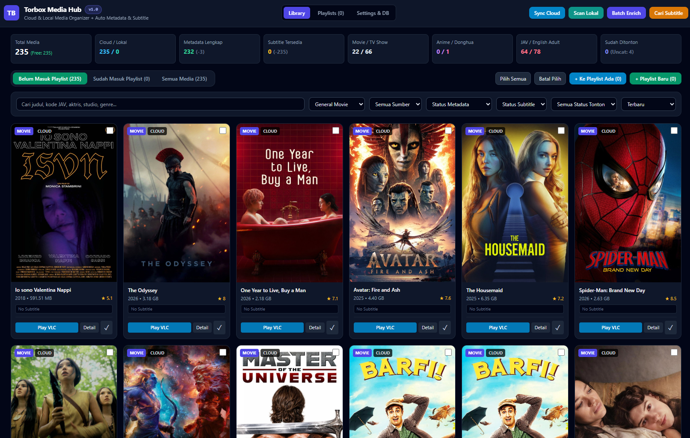
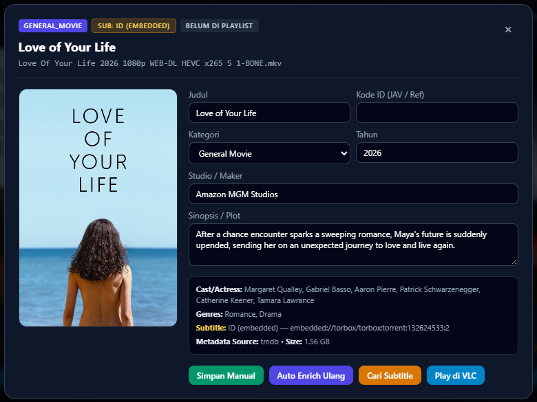

# 🎬 TorBox Media Hub `v1.3`

### Self-Hosted Stremio & Plex Alternative for TorBox — Netflix-Style UI, Multi-Indexer Episode Search, WebDL & Direct `.m3u` Streaming to VLC, MPV & Android

[](https://www.python.org/)
[](https://torbox.app/subscription?referral=d8962fcc-d39e-43f6-9a8a-f565bab5f809)
[](https://www.videolan.org/)
[](#installation--platform-guides)
[](#project-architecture)
[](https://ko-fi.com/rarafashions)
[](#license)

**TorBox Media Hub `v1.3`** is a fast, lightweight, privacy-first **visual media center, multi-indexer release finder, WebDL manager, and direct `.m3u` streaming hub** for **TorBox Cloud** (`Torrents`, `Usenet`, & `WebDL`) and **local hard drives**—**without downloading a single cloud video file to your device**.

Now featuring a sleek **Netflix-inspired UI (`v2` default on `/`)** built with zero frontend framework bloat, TorBox Media Hub lets you discover trending Movies, TV Shows, Anime, Donghua, and specialized feeds, hunt down missing series episodes across 8+ sources, verify live TorBox cache status, attach dual-language subtitles (`EN`/`ID`), and **stream directly from TorBox's high-speed CDN** into **VLC, MPV, IINA, or Android** in one click.

> 🎁 **New to TorBox?** Get **7 bonus days free** when you sign up with our **[Official TorBox Referral Link](https://torbox.app/subscription?referral=d8962fcc-d39e-43f6-9a8a-f565bab5f809)** — works with Essential, Standard, and Pro (Usenet & WebDL) plans while supporting the continued development of this open-source project!

---

## 🖼️ Preview & Screenshots

| Rich Visual Movie Catalog | Multi-Tier Subtitle Finder | Media Details & Curation Panel |
| :---: | :---: | :---: |
|  |  |  |

---

## 🆕 What's New in `v1.3`

* **Modern Netflix-Style UI (`v2` on `/`):** Completely redesigned 8-view workspace (**Home**, **Discovery**, **Library**, **Series**, **Playlists**, **Downloads**, **Statistics**, and **Settings**) built in pure vanilla JS/CSS with zero build steps—while keeping the classic interface accessible at `/legacy`.
* **Smart Library State Badges (`IN LIBRARY` & `WAS IN LIBRARY`):** Instantly see which titles are already in your collection (`IN LIBRARY`) and which ones you previously watched and deleted (`WAS IN LIBRARY` tombstone memory) across Discovery and Video Feeds.
* **Multi-Source Missing Episode Hunter:** Open any TV Show, Anime, or Donghua season to spot missing episodes and search across **TorBox Cache, TPB, EZTV, Torrentio, Nyaa, NZBIndex, NZBGeek**, and **Video Feeds** in one click—complete with live download progress bars and auto-import.
* **WebDL & Local Accelerated Downloads (`yt-dlp` / `aria2c`):** Send supported public web video links directly to **TorBox WebDL** or download streams locally using multi-connection `aria2c` / `yt-dlp` with automatic metadata classification and Library registration.
* **Dual-Language Subtitles (`EN` + `ID`) & Quality Audit:** Fetch and verify English and Indonesian subtitles side-by-side, and run per-item subtitle health audits directly from the detail panel.
* **Granular Library Curation & Quality Filters:** Filter your collection by resolution (`4K/2160p`, `1440p`, `1080p`, `720p`, `SD`), playlist assignment scope, or classification status (`Needs Review`), plus inline metadata editing, manual poster overrides, and safe physical deletion.

---

## ✨ Why TorBox Media Hub?

Managing dozens of cached torrents, Usenet downloads, WebDL links, and local video folders from plain text lists is tedious. **TorBox Media Hub** delivers a true desktop & mobile media center experience without heavy server stacks like Plex, Jellyfin, Rclone, or FUSE mounts:

* **Zero Local Disk Downloads for Cloud Media:** Your cloud videos stay 100% in the TorBox Cloud while appearing locally as a rich, Netflix-style poster catalog—saving terabytes of local storage.
* **Instant Buffering-Free Streaming — Never Expires:** Streams videos directly from TorBox's high-speed CDN via on-demand stream links generated right when you click Play or build a playlist—eliminating dead links from expired URLs.
* **Unified Discovery & 5-Source Video Feeds:** Browse Trending, Popular, and Top Rated releases across **Movies**, **TV Shows**, **Anime**, and **Donghua**, alongside dedicated configurable addon feeds for specialized catalogs—all with instant TorBox cache verification.
* **Automated Download Monitor & 1-Click Quality Upgrades:** Tracks queued TorBox downloads in the background, automatically imports and enriches them upon completion, and supports **Quality Upgrades** (automatically cleaning up older low-resolution files once the upgrade completes).
* **Deterministic Content Classification & Isolation:** Automatically separates **Movies**, **TV Shows**, **Anime**, **Donghua**, **Indonesia Movies**, **JAV**, and **English Adult** using an offline rule engine + multi-API enrichment so niche catalogs never pollute your mainstream family library.
* **4-Tier Dual-Language Subtitles (`EN` / `ID`):** Inspects embedded tracks (`ffprobe`), extracts sidecar `.srt`/`.ass` files bundled inside TorBox archives, or downloads verified English & Indonesian subtitles from OpenSubtitles & SubtitleCat—injecting them straight into your player.
* **Hardened Security & Privacy-First:** Runs 100% locally on SQLite (`WAL` mode). API keys and addon manifest URLs are masked server-side, signed stream URLs are never leaked to browser payloads, and all remote asset fetches include strict SSRF & cross-site write protection.

---

## ⚡ How It Compares to Heavy Media Stacks

| Feature | **TorBox Media Hub `v1.3`** | Plex / Jellyfin + Rclone/Zurg | Standard Stremio Setup |
| :--- | :---: | :---: | :---: |
| **Setup Time** | **2 Minutes** (Pure Python, no FUSE/mounts) | Complex (Docker, WebDAV, Rclone config) | Fast, but relies on external addons |
| **Local Disk Usage** | **Zero** for cloud videos (posters/`.srt` only) | Zero (requires virtual mount stability) | Zero |
| **Built-In Discovery & Episode Search** | **Movies/TV/Anime/Donghua + 8 Episode Indexers** | Requires Radarr/Sonarr/Prowlarr | Addon-dependent |
| **Isolated Niche Metadata & Feeds** | **Yes** (TMDb, AniList, JAVDb, TPDB + 5 Feeds) | Often pollutes main movie library | Limited |
| **4-Tier Dual-Subtitles (`EN` + `ID`)** | **Local + Cloud Archive + `ffprobe` + OpenSubtitles** | Basic / manual plugin setup | External player subtitles often break |
| **Library Memory (`IN` / `WAS IN LIBRARY`)** | **Built-in Duplicate & Deletion History Badges** | Basic watched status only | None |
| **Native Android + Desktop Players** | **VLC, MPV, IINA, PotPlayer, Android Intents** | Dedicated client apps required | Built-in player |

---

## 🌐 Multi-Environment & Cross-Platform Capabilities

TorBox Media Hub adapts automatically to the operating system and network environment where it runs:

* **Auto-OS & Player Detection:** Automatically detects **Windows**, **Linux**, **macOS**, or **Android (Termux)** and scans standard installation paths and system `PATH` for **VLC**, **MPV**, **PotPlayer**, **MPC-HC / MPC-BE**, **KMPlayer**, **IINA**, **Celluloid**, **SMPlayer**, and **Haruna**, plus custom player arguments.
* **Android Intent Integration:** When hosted natively on Android via Termux, TorBox Media Hub launches streams directly into **VLC for Android** (`org.videolan.vlc`), **mpv-android** (`is.xyz.mpv`), or the **Android System Chooser** using native `am start` video intents with external subtitle extras.
* **LAN & Headless Server Streaming:** Bind the server to `0.0.0.0` (`TBH_HOST=0.0.0.0`) on a home PC, Linux server, or NAS to browse your catalog from any phone, tablet, or TV on your Wi-Fi. Remote clients can stream local videos via HTTP Range endpoints or download LAN-ready `.m3u` playlists per item or per playlist.
* **Hybrid File & Folder Browsing:** Uses native OS file/folder dialogs (`tkinter`) when a desktop GUI is available, and seamlessly falls back to a built-in server-side filesystem browser in headless Linux, SSH, Docker, or Android Termux environments.
* **Configurable Data Directory (`TBH_DATA_DIR`):** Store your SQLite database, poster cache, subtitles, playlists, logs, and backups anywhere—ideal for external drives or NAS mounts.

---

## 🚀 Core Features

### 1. Netflix-Style Home, Library & Series Tracker
* **Home Dashboard:** Featured billboard showcase, quick-filter statistics strip, shortcuts, and dynamic category rails (**Recently Added**, **Unwatched**, **Top Rated**, and per-category shelves).
* **Granular Library Filtering & Bulk Actions:** Filter simultaneously by **Category**, **Playlist Scope** (`All`, `Unassigned`, `In Playlists`), **Source** (`TorBox Cloud` / `Local`), **Resolution** (`4K`, `1440p`, `1080p`, `720p`, `SD`), **Watch Status**, **Subtitle Status**, **Cover Status**, and **Classification Status** (`Needs Review`, `Classified`, `Manual`).
* **Series & Season Completeness Engine:** Groups TV Shows, Anime, and Donghua by season, compares your files against official episode counts (TMDb, TVMaze, AniList, Jikan), highlights missing episodes, and searches 8+ torrent/NZB/addon sources with live progress bars and auto-import.

### 2. Multi-Category Discovery, Cache Search & Video Feeds
* **Mainstream Discovery:** Explore Trending, Popular, Top Rated, or Search across **Movies**, **TV Shows**, **Anime**, and **Donghua**, inspect synopses/ratings, check live TorBox cache across 7+ indexers, and queue magnets or NZBs in one click.
* **Configurable Video Feeds:** Connect up to 5 independent addon manifests (**JAV**, **English Adult**, **OnlyFans**, **Indonesia Movies**, **Donghua**), search across all supported catalogs simultaneously, inspect stream options, and launch **TorBox Cloud**, **WebDL**, or local **`yt-dlp` / `aria2c`** downloads with automatic Library registration.

### 3. Multi-Source Metadata & Offline Classification Engine
* **Deterministic Rule Engine (`classification_engine.py`):** Evaluates local Indonesian signals, validated JAV studio production codes (`FC2-PPV`, `HEYZO`, `CARIB`, etc.), adult lexicons, fansub tags, and CJK metadata offline before enriching via **TMDb**, **TVMaze**, **AniList**, **JAVDatabase**, and **ThePornDB (TPDB)**.
* **Automatic `ffprobe` Runtime Detection:** Probes container headers on local files and live TorBox streams to display exact duration badges (`1h 58m`).

### 4. 4-Tier Dual-Language Subtitle Engine & Quality Audit
1. **Local Sidecar Detection:** Finds matching `.srt`, `.ass`, `.ssa`, `.vtt`, or `.sub` files alongside local videos with episode-tag verification.
2. **TorBox Cloud Archive Indexing:** Scans inside TorBox torrent/Usenet file trees for bundled subtitle files and caches only the lightweight subtitle text file.
3. **Embedded Track Inspection (`ffprobe`):** Inspects `.mkv`/`.mp4` container headers on both local files and live TorBox Cloud streams.
4. **Public Providers (`EN` + `ID`):** Fetches English and Indonesian subtitles from **OpenSubtitles REST API** and **SubtitleCat**, backed by an on-demand **Subtitle Quality Audit** (encoding, timing, language, and sync validation).

### 5. Curated `.m3u` Playlists & LAN Remote Streaming
* Build custom `.m3u` playlists with `#EXTINF` runtimes, external subtitle injection (`#EXTVLCOPT:sub-file=...`), and fresh on-demand TorBox stream URLs—or generate LAN-ready `.m3u` links for mobile phones and smart TVs on your local network.

---

## 📂 Project Architecture

```text
TorBoxMediaHub/
├── app.py                        # Flask server, REST API, Discovery, Episode Search, Monitor & M3U Builder
├── database_manager.py           # SQLite WAL management, migrations, secret masking, tombstones & backups
├── metadata_engine.py            # TMDb/TVMaze/AniList/JAVDb/TPDB clients, poster cache & ffprobe runtime
├── classification_engine.py      # Deterministic multi-category classifier & JAV code validator
├── indo_keyword_engine.py        # Indonesian signal & dictionary scoring engine
├── subtitle_engine.py            # 4-tier subtitle engine (Sidecar, Cloud Archive, ffprobe, OpenSubtitles/SubtitleCat)
├── dual_subtitle_engine.py       # Dual-language (EN/ID) subtitle track resolver
├── subtitle_quality_audit.py     # Encoding, timing, and sync quality auditor
├── roxxy_module.py               # 5-source addon manifest client, catalog search & stream analyzer
├── roxxy_download_engine.py      # yt-dlp / aria2c download worker & D1–D3 auto-Library registration
├── webdl_resolver.py             # Public page WebDL resolver & host validation
├── adult_providers.py            # Provider registry & allowlist management
├── adult_discovery.py            # Catalog/search caching & circuit breaker
├── adult_streams.py              # Direct provider stream extractor
├── platform_support.py           # OS & media player auto-detection (Windows/Linux/macOS/Android)
├── static/ui/                    # Framework-free Netflix-style UI v2 (JS/CSS)
├── templates/
│   ── index.html                 # Classic UI v2
├── database/                     # Local SQLite database (torbox_media_hub.db)
├── cache/                        # Cached posters & .srt/.ass subtitles only
├── playlists/                    # Generated .m3u playlist files
├── logs/                         # Rotating application logs (app.log)
└── backups/                      # SQLite database backups
```

---

## 🛠️ Installation & Platform Guides

### Prerequisites (All Platforms)
* **Python 3.10+** (3.12 recommended)
* **Git** (or download the repository ZIP)
* **FFmpeg / `ffprobe`** *(recommended for video duration probing and embedded subtitle detection)*
* **Media Player:** **VLC**, **MPV**, **IINA**, or any supported external player
* **Optional Accelerators:** **`yt-dlp`** and **`aria2c`** *(for local HLS/DASH and multi-connection direct downloads in Video Feeds)*

---

### 🪟 Windows (Windows 10 / 11)

1. **Install Python, Git, FFmpeg, VLC & Download Accelerators** (via PowerShell using `winget`):
   ```powershell
   winget install Python.Python.3.12 Git.Git Gyan.FFmpeg VideoLAN.VLC yt-dlp.yt-dlp aria2.aria2
   ```
   *(Restart PowerShell after installation so `python`, `git`, `ffprobe`, `yt-dlp`, and `aria2c` are available in `PATH`.)*

2. **Clone & Set Up Virtual Environment:**
   ```powershell
   git clone https://github.com/rarafashions/TorBoxMediaHub.git
   cd TorBoxMediaHub
   py -3 -m venv venv
   .\venv\Scripts\Activate.ps1
   pip install -r requirements.txt
   ```

3. **Run TorBox Media Hub:**
   ```powershell
   python app.py
   ```
   Open `http://127.0.0.1:5050` in your browser.

---

### 🐧 Linux (Ubuntu / Debian / Fedora / Arch)

1. **Install System Dependencies:**
   * **Ubuntu / Debian:**
     ```bash
     sudo apt update
     sudo apt install -y python3 python3-venv python3-pip python3-tk git ffmpeg vlc mpv aria2 yt-dlp
     ```
   * **Fedora:**
     ```bash
     sudo dnf install -y python3 python3-tkinter git ffmpeg vlc mpv aria2 yt-dlp
     ```
   * **Arch Linux:**
     ```bash
     sudo pacman -S --needed python tk git ffmpeg vlc mpv aria2 yt-dlp
     ```
   *(Note: `python3-tk` enables native desktop folder/file pickers; on headless servers without a GUI, the app automatically switches to its built-in web filesystem browser.)*

2. **Clone & Install Python Packages:**
   ```bash
   git clone https://github.com/rarafashions/TorBoxMediaHub.git
   cd TorBoxMediaHub
   python3 -m venv venv
   source venv/bin/activate
   pip install -r requirements.txt
   ```

3. **Run TorBox Media Hub:**
   ```bash
   python app.py
   ```
   Open `http://127.0.0.1:5050` in your browser.

---

### 🍎 macOS (Intel & Apple Silicon)

1. **Install Homebrew Dependencies:**
   ```bash
   brew install python git ffmpeg aria2 yt-dlp
   brew install --cask vlc iina
   ```
   *(Optional: `brew install mpv` if you prefer MPV alongside VLC or IINA.)*

2. **Clone & Install Python Packages:**
   ```bash
   git clone https://github.com/rarafashions/TorBoxMediaHub.git
   cd TorBoxMediaHub
   python3 -m venv venv
   source venv/bin/activate
   pip install -r requirements.txt
   ```

3. **Run TorBox Media Hub:**
   ```bash
   python app.py
   ```
   Open `http://127.0.0.1:5050` in Safari or Chrome.

---

### 📱 Android (Termux + VLC / mpv-android)

You can run TorBox Media Hub directly on your Android phone or tablet using **Termux** and launch streams natively into **VLC for Android** or **mpv-android**.

1. **Install Required Android Apps:**
   * Install **Termux** (recommended from [F-Droid](https://f-droid.org/en/packages/com.termux/) or GitHub Releases—avoid the outdated Google Play version).
   * Install **VLC for Android** and/or **mpv-android** from Google Play or F-Droid.

2. **Set Up Termux Environment:**
   Open Termux and run:
   ```bash
   pkg update && pkg upgrade -y
   pkg install -y python git ffmpeg aria2 yt-dlp
   termux-setup-storage
   ```

3. **Clone & Install Dependencies:**
   ```bash
   git clone https://github.com/rarafashions/TorBoxMediaHub.git
   cd TorBoxMediaHub
   pip install -r requirements.txt
   ```

4. **Start the Server & Configure Android Player:**
   ```bash
   python app.py
   ```
   *(Tip: Run `termux-wake-lock` in Termux so Android doesn't suspend the background server while streaming.)*
   * Open `http://127.0.0.1:5050` in your mobile browser.
   * Go to **Settings**, click **Auto-Detect** under Media Player, and select **VLC for Android (Intent)**, **mpv-android (Intent)**, or **Android System Chooser**.

---

### 🌍 Optional Environment Variables (LAN Access, Custom Port & Data Storage)

| Variable | Default | Description |
| :--- | :--- | :--- |
| `TBH_HOST` | `127.0.0.1` | Set to `0.0.0.0` to allow access from phones, tablets, or smart TVs on your local Wi-Fi/LAN. |
| `TBH_PORT` | `5050` | Change the web server port (e.g., `8080`). |
| `TBH_DATA_DIR` | `./` (Project Root) | Custom directory path for `database/`, `cache/`, `playlists/`, `logs/`, and `backups/`. |

**Example (Expose on LAN & Custom Port):**
* **Linux / macOS / Android:**
  ```bash
  TBH_HOST=0.0.0.0 TBH_PORT=8080 python app.py
  ```
* **Windows (PowerShell):**
  ```powershell
  $env:TBH_HOST="0.0.0.0"; $env:TBH_PORT="8080"; python app.py
  ```

---

## ⚙️ Initial Configuration

1. Open the **Settings** view in the web interface (`http://127.0.0.1:5050`).
2. Enter your **TorBox API Key** from [TorBox Settings](https://torbox.app/settings) *(Don't have an account yet? [Sign up via our referral link](https://torbox.app/subscription?referral=d8962fcc-d39e-43f6-9a8a-f565bab5f809) to get **7 free bonus days**!)*.
3. Enter your free **TMDb API Key (v3)** (plus optional **TPDB API Key** and **NZBGeek API Key** for premium Usenet episode searches).
4. Click **Auto-Detect** under **Media Player** (or browse/enter your player executable path) and optionally add **Local Scan Folders**.
5. Toggle **Indonesian Subtitles** if you want dual-language (`EN` + `ID`) subtitle fetching alongside English.

---

## 🔄 Typical Workflow

1. **Discover or Hunt Missing Episodes:** Open **Discovery** to browse trending Movies, TV Shows, Anime, or Donghua—or open **Series** to detect missing season episodes and add cached releases to TorBox Cloud with automatic background import.
2. **Sync Cloud & Local Folders:** Click **Sync Cloud** to index your TorBox torrents, Usenet, and WebDL items without downloading video files (and optionally **Scan Local** for existing folders).
3. **Enrich Metadata & Runtimes:** Click **Enrich Meta** to classify titles, group series/seasons, probe real video durations, and cache cover posters.
4. **Fetch & Audit Subtitles:** Click **Find Subtitles** to detect embedded tracks, extract TorBox archive subtitles, or download verified `EN`/`ID` `.srt` files.
5. **Curate & Stream Anywhere:** Hit **Play** on any movie, episode, or full season—or generate `.m3u` playlists—to stream directly from TorBox into your desktop, Android, or LAN media player.

---

## ❓ Frequently Asked Questions (FAQ)

**Does TorBox Media Hub download video files to my hard drive or phone?**
No. Cloud videos remain 100% on TorBox servers and stream directly to your media player via on-demand API links. Only tiny poster thumbnails and `.srt` subtitle files are cached locally (unless you explicitly start a local download via Video Feeds).

**What do the `IN LIBRARY` and `WAS IN LIBRARY` badges mean?**
`IN LIBRARY` (green) shows that a movie, episode, or feed item is currently in your catalog so you avoid duplicate downloads. `WAS IN LIBRARY` (amber) lets you know you previously had and deleted that title—helpful when browsing large feeds so you don't accidentally re-download something you already watched.

**Can I use TorBox Media Hub on Android without a PC?**
Yes. You can run TorBox Media Hub natively on any Android phone or tablet using **Termux** and launch streams directly into **VLC for Android** or **mpv-android** with subtitles attached—or host it on a home PC/NAS (`TBH_HOST=0.0.0.0`) and stream over Wi-Fi.

**Do I need a paid TorBox account?**
You can test basic syncing with a free TorBox account, while a paid plan (**Essential**, **Standard**, or **Pro** for Usenet NZB caching & WebDL) unlocks high-speed direct streaming and instant cache additions. [Claim 7 bonus days free here](https://torbox.app/subscription?referral=d8962fcc-d39e-43f6-9a8a-f565bab5f809).

**How does Quality Upgrade work?**
When searching for releases on an existing movie or episode, you can replace a lower-resolution copy (e.g., upgrading `720p` to `4K HDR`). Once TorBox finishes caching the upgrade, TorBox Media Hub automatically imports the new file and cleans up the old low-resolution copy.

---

## 🗺️ Roadmap

* [x] **Zero-Download Rich Catalog & Direct API Streaming (`v1.0`):** Visual poster catalog with on-demand stream URLs and zero local video storage overhead.
* [x] **Multi-Platform Player Support & Cache Search (`v1.1`):** Auto-detection for Windows, Linux, macOS, and Android Intents, LAN HTTP streaming, and multi-indexer cache checks.
* [x] **Netflix-Style UI v2, Episode Hunter & Library Tombstones (`v1.3`):** Framework-free 8-view UI (`/`), 8-source missing episode search with live download trays, WebDL + `yt-dlp`/`aria2c` auto-import, dual-language (`EN`/`ID`) subtitles, and `IN LIBRARY` / `WAS IN LIBRARY` tracking.
* [ ] **Live HTTP M3U Redirect Endpoint (`/stream/<unique_key>`):** Serve permanent local M3U URLs that dynamically redirect to fresh stream links at playback time.
* [ ] **Docker & Docker Compose Support:** Ready-to-use `Dockerfile` for Unraid, Synology NAS, and home-server deployments.

---

## 🤝 Contributing & Support

Contributions, bug reports, and feature requests are always welcome!
* **Issues & Pull Requests:** Feel free to open an issue or submit a PR on [GitHub](https://github.com/rarafashions/TorBoxMediaHub).
* **Buy Me a Coffee & Request Custom Features:** Love the app? Support ongoing development on **[Ko-fi (`ko-fi.com/rarafashions`)](https://ko-fi.com/rarafashions)** — Ko-fi supporters can submit **custom feature requests** directly to the developer!
* **TorBox Referral:** New to TorBox or renewing? Use our **[TorBox Referral Link](https://torbox.app/subscription?referral=d8962fcc-d39e-43f6-9a8a-f565bab5f809)** to receive **7 bonus days free**.

---

## 📄 License

This project is open-source and available under the **MIT License**.